<h1 align="center">Deepak Kumar</h1>

  

  
  
  

---

## About

I'm a Full Stack and Blockchain Developer at **Kriti Digital Solutions**, based in Agra, India. I build complete products: EVM smart contracts, backend APIs, dashboards, and the cloud infrastructure that runs them.

- **Focus:** Scalable backend systems, EVM smart contracts, real-time applications
- **Domains:** FinTech and on-chain investment, OTT and social media, multi-vendor commerce
- **Approach:** Clean architecture, secure by default, and built to run in production

---

## Tech Stack

<table>
  <tr>
    <td width="150"><b>Languages</b></td>
    <td></td>
  </tr>
  <tr>
    <td><b>Blockchain</b></td>
    <td>
      
      
      
      
      
      
    </td>
  </tr>
  <tr>
    <td><b>Frontend</b></td>
    <td></td>
  </tr>
  <tr>
    <td><b>Backend</b></td>
    <td></td>
  </tr>
  <tr>
    <td><b>Databases</b></td>
    <td></td>
  </tr>
  <tr>
    <td><b>Cloud &amp; DevOps</b></td>
    <td></td>
  </tr>
  <tr>
    <td><b>Tools</b></td>
    <td></td>
  </tr>
</table>

---

## What I Build

  

---

## Featured Projects

<table>
  <tr>
    <td width="33%" valign="top">
      <h3>HorizonCapWorld</h3>
      <b>Blockchain Investment Platform</b>
      
USDT (BEP-20) investment platform on BNB Smart Chain. Each user gets their own deposit forwarder contract, payouts come from an on-chain payout pool, and the platform includes multi-level referral commissions and an admin control panel.

      Solidity · Foundry · OpenZeppelin · Ethers.js · React · Node.js · MongoDB · Redis
    </td>
    <td width="33%" valign="top">
      <h3>CatchAndWatch</h3>
      <b>Entertainment &amp; Social Media Platform</b>
      
Video streaming and social platform with creator content, real-time chat, notifications, subscriptions, and creator monetization.

      React · Node.js · Express · Socket.IO · MongoDB · JWT
    </td>
    <td width="33%" valign="top">
      <h3>Multi-Vendor E-Commerce</h3>
      <b>Marketplace Platform</b>
      
Marketplace with vendor onboarding, a commission engine, delivery charges, revenue tracking, and Razorpay payment integration.

      React · Node.js · Express · MongoDB · Razorpay
    </td>
  </tr>
</table>

---

## Currently Learning

| Area | Focus |
| --- | --- |
| **Blockchain Technology** | Advanced Solidity patterns, DeFi protocols, smart contract security and auditing |
| **Agentic AI** | LLM agents, tool calling, multi-step autonomous workflows |

---

## GitHub Stats

  
  

  

  

